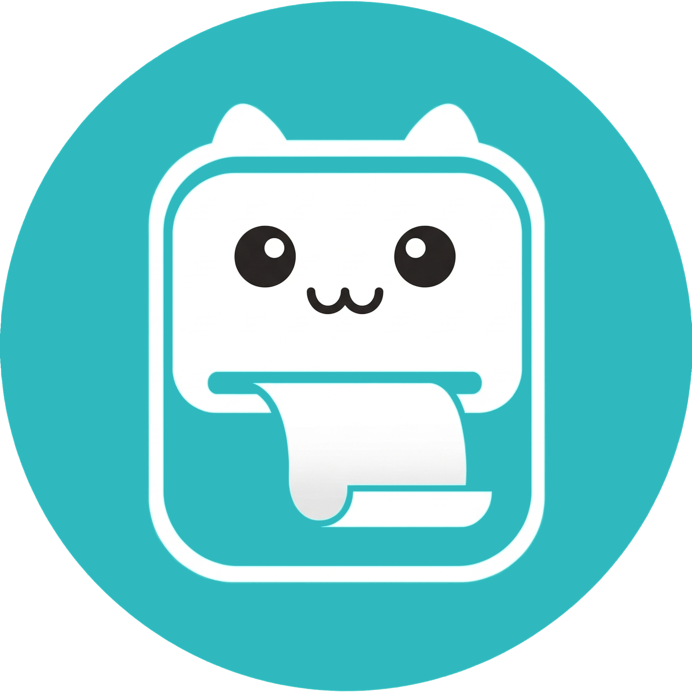
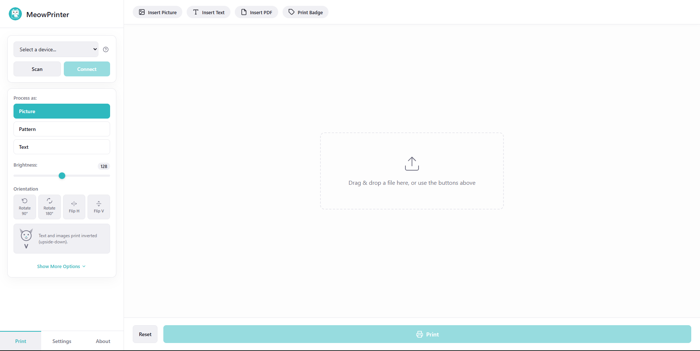
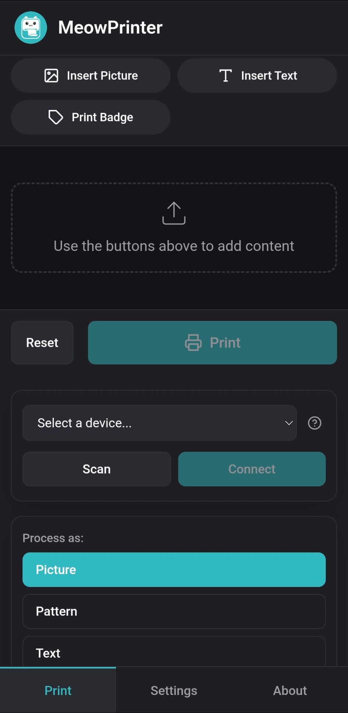
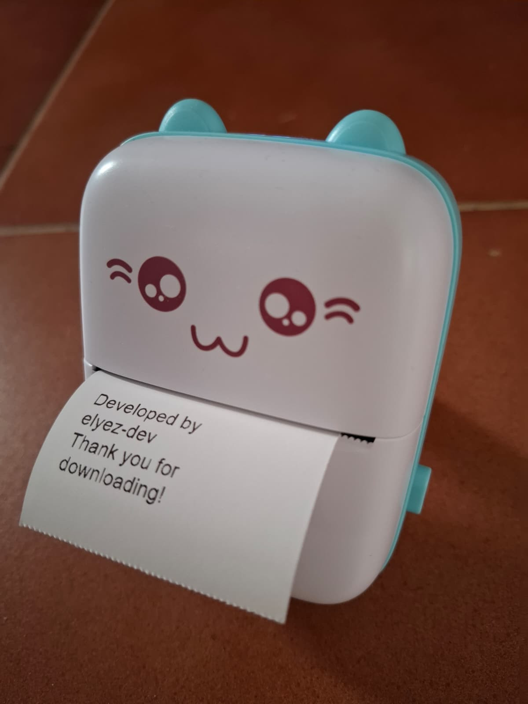

# MeowPrinter




Open-source toolkit for BLE thermal cat printers (GB01, PD01, and compatible models).

Includes a **web UI** (desktop + Android), a **CLI**, and a **Python library** for scripting labels, tickets, address strips, and more.

## Features

- **Web UI** — drag-and-drop images, draw text, preview with thermal simulation, live brightness/dither controls
- **BLE scanning & connection** — works on desktop (bleak) and Android
- **Print modes** — Floyd-Steinberg dithering, halftone (Bayer 4×4), direct threshold
- **PDF printing** — renders each page and sends it to the printer (only PC)
- **Badge / QR label** — auto detects barcodes and qr codes in images and prints them with appropriate size
- **Ticket system** — script to print numbered tickets with custom headers, printed from CLI (only PC)
- **Address labels** — script to print mailing address strips, printed sideways for maximum font size (only PC)
- **Multilingual UI** — English, Spanish, German, Chinese (4 variants), lolcat
- **Android APK** — self-contained app built with Buildozer + Docker, no Android Studio required
- **CLI** — scan, print images/text, serve the web UI, generate tickets and address labels

<table><tr>
<td></td>
<td></td>
</tr></table>

## Supported printers

| Model | Notes |
|-------|-------|
| PD01  | Fully supported, including PD01-specific tail-feed tuning |
| GB01, GB02 | Standard generation cat printers |
| GB03  | Supports compressed bitmaps (`requires_new_start` protocol) |
| GT01, YT01 | Standard protocol, fully compatible |
| MX05, MX06, MX08 | Feed-quirk workaround applied automatically |
| Other cat-printer-compatible models | Very likely to work — try `--model GB01` first |

> Models follow the naming convention used by the underlying BLE protocol.
> `GB0X` covers GB01–GB09; `MX0X` covers those variants similarly.

## Repository structure

```
MeowPrinter/
├── backend/                 Python package (FastAPI server + CLI + driver)
│   └── src/meowprinter/
├── frontend/                Preact + Vite web UI
│   └── src/
├── android_java_src/        Java patches compiled into the Android APK
├── main.py                  Android p4a entry point
├── buildozer.spec           Android build configuration
├── build-android.ps1        One-command Android build (Windows)
├── build-android.sh         One-command Android build (Linux/macOS)
├── build-helper.sh          Helper script that runs inside Docker
└── docs/
    ├── installation-pc.md   Desktop installation guide
    └── build-android.md     Android APK build guide
```

The `meowprinter/`, `www/`, and `bin/` folders at the project root are
**generated automatically** by the build script and are not committed to git.

## Quick start

### Desktop (web UI)

```bash
# 1. Install the Python package (see docs/installation-pc.md for full details)
cd backend
pip install -e ".[all]"

# 2. Build the frontend
cd ../frontend
npm install
npm run build

# 3. Run the server
cd ../backend
python -m meowprinter.cli serve
# → Open http://localhost:8095 in your browser
```

### Android APK

```powershell
# Windows — requires Docker Desktop
.\build-android.ps1
# APK lands in bin\meowprinter-1.0.0-arm64-v8a-debug.apk
```

See [docs/build-android.md](docs/build-android.md) for the full guide and known issues.

## CLI reference

```
meowprinter-cli scan                         Scan for nearby printers
meowprinter-cli print-image FILE             Print an image
meowprinter-cli print-text "hello"           Render and print text
meowprinter-cli serve                        Start the web UI server

python -m meowprinter.tickets                Generate / print numbered tickets
python -m meowprinter.addresses              Generate / print address labels
```

Run any subcommand with `--help` for full options.

## Legal disclaimer

This project communicates with thermal printers over Bluetooth Low Energy using
a protocol that has been reverse-engineered from publicly observable traffic.
**I am not affiliated with, endorsed by, or connected to any manufacturer or
their official applications.** Reverse engineering for interoperability purposes
is widely recognised as lawful under applicable law (including EU Directive
2009/24/EC and relevant US case law). No proprietary code, firmware, or assets
were copied or redistributed.

## Acknowledgements

MeowPrinter builds on the work of many people and projects:

**Direct foundations**
- [Cat-Printer](https://github.com/NaitLee/Cat-Printer) by **NaitLee** — the original
  open-source cat printer toolkit from which this project was based on. Without it, none of this would have been possible.
- [catprinter](https://github.com/rbaron/catprinter) by **rbaron** — an early
  reverse-engineering effort that helped establish the BLE protocol.
- [catprinter](https://github.com/rhnvrm/catprinter) by **rhnvrm** — another
  independent implementation that contributed to protocol understanding.

**Core technologies**
- [Python](https://www.python.org/) — the backbone of the whole backend.
- [Bleak](https://bleak.readthedocs.io/en/latest/) — the Bluetooth Low Energy library
  that makes cross-platform BLE scanning and connection possible.
- [FastAPI](https://fastapi.tiangolo.com/) + [Uvicorn](https://www.uvicorn.org/) —
  the desktop web server.
- [Pillow](https://python-pillow.org/) — image loading, dithering, and PBM generation.
- [pyzbar](https://github.com/NaturalHistoryMuseum/pyzbar) — barcode and QR code decoding.
- [Preact](https://preactjs.com/) + [@preact/signals](https://preactjs.com/guide/v10/signals/) —
  the lightweight frontend framework and reactive state layer.
- [Vite](https://vite.dev/) — frontend build tooling and dev server.
- [TypeScript](https://www.typescriptlang.org/) — type safety across the frontend.

**Android build**
- [python-for-android (p4a)](https://python-for-android.readthedocs.io/en/latest/) —
  the toolchain that compiles Python and its dependencies for Android. Powerful,
  though occasionally painful.
- [Buildozer](https://buildozer.readthedocs.io/en/latest/) — the build system that
  orchestrates p4a and produces the APK.
- [kivy/buildozer Docker image](https://hub.docker.com/r/kivy/buildozer) — makes
  reproducible Android builds possible on any machine with Docker.
- [AdvancedWebView](https://github.com/delight-im/Android-AdvancedWebView) — a lifesaver
  that informed the WebChromeClient file-picker implementation without requiring a full
  Java rewrite.

## License

GPL-3.0-or-later — see [LICENSE](LICENSE).

## Pre-built APK

If you don't want to go through the pain that I suffered when building the APK yourself, I have good news for you! You can download and try the APK for free [here](https://elyez-dev.itch.io/meowprinter), consider making a donation!

## Author



My profile: [elyez-dev](https://github.com/elyez-dev)

---


